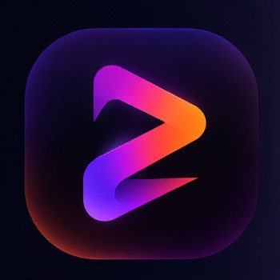
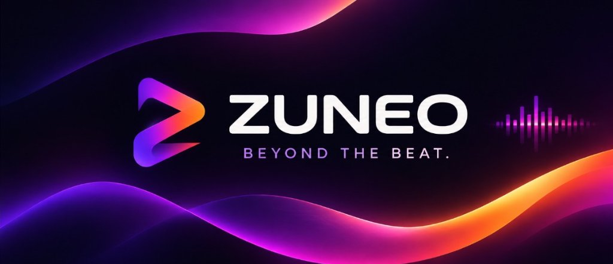

<div align="center">

  <br/>

  <a href="https://github.com/sudeepdevOPS5/ZUNEO-Beyond-the-beat">
    
  </a>

  <br/><br/>

  <h1>✦ Z U N E O ✦</h1>
  <p><b>BEYOND THE BEAT.</b></p>
  <p><i>Next-Generation Android Music Streaming with OPPO ColorOS Aquamorphic UI</i></p>

  <br/>

  <!-- Badges -->
  <p>
    <a href="https://github.com/sudeepdevOPS5/ZUNEO-Beyond-the-beat/releases/latest">
      
    </a>
    <a href="LICENSE">
      
    </a>
    <a href="https://github.com/sudeepdevOPS5/ZUNEO-Beyond-the-beat">
      
    </a>
    <a href="https://github.com/sudeepdevOPS5/ZUNEO-Beyond-the-beat">
      
    </a>
  </p>

  <!-- Big Download CTA Button -->
  <p>
    <a href="https://github.com/sudeepdevOPS5/ZUNEO-Beyond-the-beat/releases/latest">
      
    </a>
  </p>

  <sub>⚡ Android 8.0+ (API 26+) • 64-bit ARM & Universal • Zero Ads • 100% Privacy</sub>

  <br/><br/>

  <!-- Panoramic Banner -->
  <a href="https://github.com/sudeepdevOPS5/ZUNEO-Beyond-the-beat">
    
  </a>

</div>

<br/>

---

## 🌟 About ZUNEO

**ZUNEO** is a premium, open-source music streaming application engineered for audiophiles. Combining high-fidelity streaming with the refined elegance of **OPPO ColorOS Aquamorphic Design**, ZUNEO delivers a fluid, organic, and ultra-responsive listening experience with zero ads and complete privacy.

---

## ✨ Key Features

- 💧 **ColorOS Aquamorphic Design Language** — Solid premium matte surfaces, diffuse ambient shadows, water-drop spring physics, and generous rounded corners (24dp–28dp) with zero GPU-draining blur lag.
- 🎧 **Rock-Solid Background Playback** — Built on AndroidX Media3 (`MediaSessionService`). Full lockscreen controls, notification drawer controls, and seamless background streaming that never gets killed by battery savers.
- 🌊 **Live Waveform Seek Bar** — Dynamic audio waveform scrubber synchronized in real-time with track playback and tactile haptic feedback.
- 🎤 **Multi-Provider Synchronized Lyrics** — Real-time timestamped lyrics with syllable-by-syllable karaoke highlights, backed by automatic fallback across LRCLIB, Kugou, and Musixmatch.
- 📥 **1-Click Universal Importer** — Paste any playlist or album share link from Spotify, Apple Music, or YouTube Music to import instantly.
- 🔄 **Spotify Sync & ZUNEO Wrapped** — Connect your Spotify account to mirror playback stats, complete with Spotify-style yearly wrapped summaries and top-artist stories.
- 📦 **Offline Caching & Local Library** — Powered by a high-speed Android Room database. Cache songs automatically for instant re-play without consuming mobile data.
- 🔍 **Audio Recognition (ShazamKit)** — Identify songs playing around you with a single tap.
- 💬 **Discord Rich Presence** — Showcase your current track, album art, and progress directly on your Discord profile.
- 🚗 **Car Audio & Android Auto Ready** — Full Bluetooth metadata synchronization, steering wheel controls, and auto-pause on disconnect.
- 🛡️ **100% Privacy & Zero Commercials** — No ads, no third-party tracking, no bloat.

---

## 🎨 Brand Palette

ZUNEO features a signature dark aesthetic crafted for OLED displays:

- **Deep Black**: `#080610`
- **Midnight Purple**: `#160B2B`
- **Card Surface**: `#20252B`
- **Electric Violet (Accent)**: `#7028FF`
- **Magenta Accent**: `#E52BCA`
- **Sunset Orange**: `#FF8A24`
- **High-Contrast Text**: `#FFFFFF` / `#A0A7B0`

---

## 📱 Tech Stack & Architecture

- **Language**: Kotlin 2.x with Coroutines & StateFlow
- **UI Framework**: Jetpack Compose + Material 3 + Custom ColorOS Aquamorphic primitives
- **Audio Engine**: AndroidX Media3 (ExoPlayer + MediaSessionService)
- **Local Persistence**: Room Database (SQLite) + Jetpack DataStore Preferences
- **Dependency Injection**: Google Dagger / Hilt
- **Network / API**: InnerTube (YouTube Music), JioSaavn, Spotify Web API, LRCLIB
- **Image Pipeline**: Coil 3 with disk caching and smooth crossfade
- **Minimum OS**: Android 8.0 (API 26+) | **Target OS**: Android 15/16 (API 36)

---

## 🚀 Building & Running from Source

1. Clone the repository:
   ```bash
   git clone https://github.com/sudeepdevOPS5/ZUNEO-Beyond-the-beat.git
   ```
2. Open the project in **Android Studio** (Ladybug or newer).
3. Allow Gradle to sync dependencies.
4. Select the **`gmsDebug`** or **`fossDebug`** build variant.
5. Connect your Android device (or start an emulator) and click **Run (Shift + F10)**.

---

## 📄 License

ZUNEO is licensed under the [GNU General Public License v3.0](LICENSE).

<div align="center">
  <br/>
  <p>⭐ <b>Star this repository if you love ZUNEO!</b></p>
  <sub>Crafted with passion for pure music • BEYOND THE BEAT.</sub>
</div>
